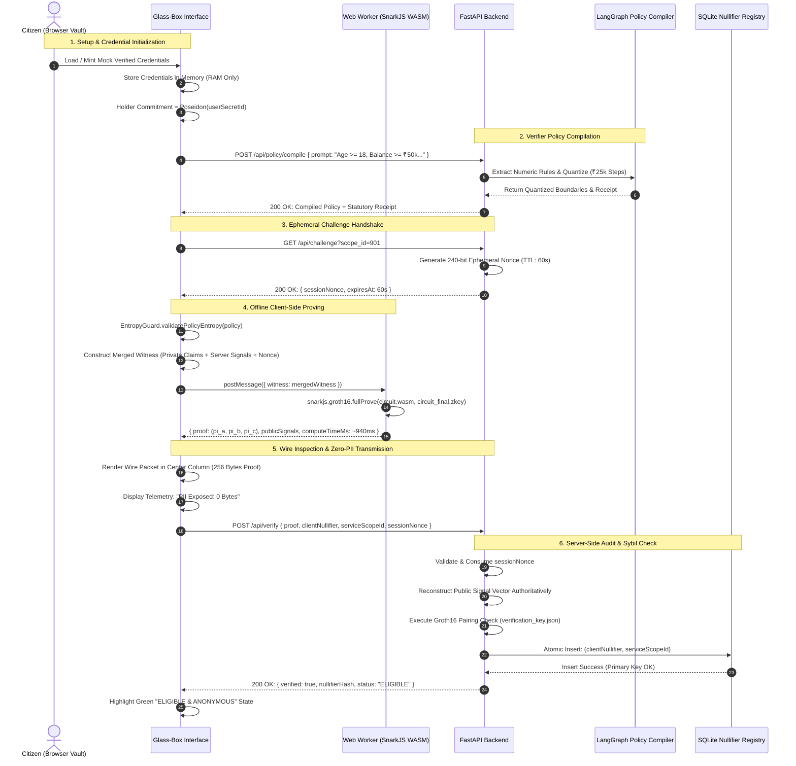
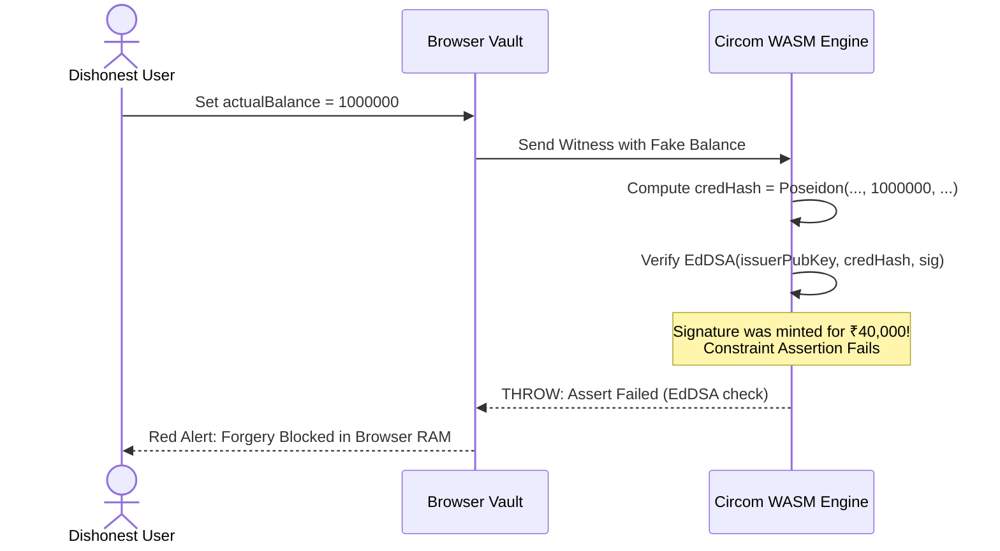
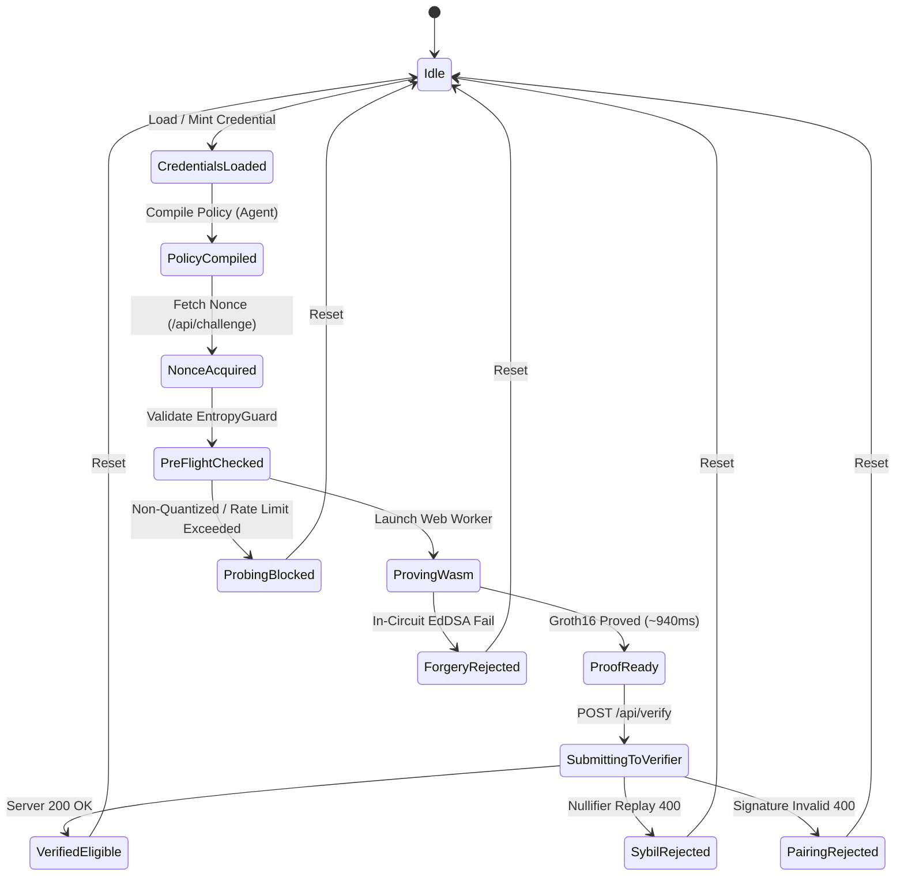

# zkode: Application Flow & User Journeys (`appflow.md`)

## 1. Overview
`zkode` demonstrates a real-time, interactive Zero-Knowledge eligibility handshake. The user interface is a unified 3-Column "Glass-Box" dashboard where the citizen's private storage, the public wire transport, and the verifier's authority are displayed side-by-side.

---

## 2. End-to-End Happy Path Workflow



---

## 3. Red-Team Exploit Simulation Flows

### 3.1 Exploit 1: Tampered Balance (Client Memory Injection)
* **Goal:** A dishonest citizen modifies their browser memory from ₹40,000 to ₹10,00,000 to satisfy a high-balance requirement.
* **Flow:**
  1. User clicks **"Inject Fake ₹10L Balance"** in the Red-Team Attack Bar.
  2. UI updates the in-memory `actualBalance = 1000000`.
  3. The citizen clicks **"Generate Proof (WASM)"**.
  4. The Web Worker executes the Circom constraint system:
     * Constraint 1: `holderHasher` computes commitment.
     * Constraint 2: `credHasher` computes `Poseidon(holder, birth, 1000000, ...)`.
     * Constraint 3: `sigVerifier` (`EdDSAPoseidonVerifier`) verifies the Issuer's signature against the new hash.
  5. **FAILURE:** The digital signature was computed by the bank over ₹40,000, not ₹10,00,000.
  6. The Web Worker immediately throws an error: `Error: Assert Failed. In-circuit EdDSA signature verification failed`.
  7. **UI Feedback:** Left Column flashes red: *"Cryptographic Forgery Detected: Credential hash does not match Issuer signature."* Wire packet transmission is aborted.



---

### 3.2 Exploit 2: Proof Replay & Sybil Double-Dipping
* **Goal:** An attacker intercepts a valid proof over the network and attempts to reuse it to claim the benefit a second time.
* **Flow:**
  1. User clicks **"Replay Old Proof"** in the Attack Bar.
  2. The UI submits the exact same proof and `clientNullifier` that was already registered for `serviceScopeId = 901`.
  3. FastAPI receives `POST /api/verify`.
  4. Nonce validation fails if using an old nonce (expired), OR if attacker generates a new nonce, the Groth16 proof pairing fails because `sessionChallengeNonce` is locked in the proof.
  5. Even if an attacker replays within the 60-second window:
     * Groth16 pairing succeeds.
     * Database step executes:
       ```sql
       INSERT INTO nullifier_registry (nullifier_hash, service_scope_id) VALUES (?, ?);
       ```
     * SQLite raises `sqlite3.IntegrityError: UNIQUE constraint failed: nullifier_registry.nullifier_hash, nullifier_registry.service_scope_id`.
  6. Server returns HTTP 400:
     ```json
     {
       "verified": false,
       "error": "Sybil double-dip violation: Nullifier already claimed for this service scope.",
       "sybilBlocked": true
     }
     ```
  7. **UI Feedback:** Center/Right columns flash amber: *"Sybil Attack Blocked: Duplicate Nullifier Rejected."*

---

### 3.3 Exploit 3: Binary-Search Probing Attack
* **Goal:** A predatory service attempts sequential fine-grained queries (`>= ₹50,000`, `>= ₹75,000`, `>= ₹62,500`) to deduce the user's exact net worth.
* **Flow:**
  1. Attacker verifier sends a policy with `minBalanceRequired = 63412`.
  2. The client-side **Entropy Guard** intercepts the query before passing it to the Web Worker:
     ```typescript
     if (balance % 25000 !== 0) {
       throw new Error("SECURITY EXCEPTION: Asset threshold is not quantized to ₹25,000 increments.");
     }
     ```
  3. Prover execution is instantly aborted locally.
  4. In addition, if queries occur at intervals $< 4$ seconds, the client rate limiter locks the query engine.
  5. **UI Feedback:** Center Column displays shield alert: *"Probing Attack Blocked: Policy query violates ₹25,000 quantization boundary."*

---

### 3.4 Exploit 4: Expired Credential Exploitation
* **Goal:** User attempts to present an expired income certificate from 2024.
* **Flow:**
  1. Credential `expirationTimestamp = 20240101`.
  2. Server provides authoritative `currentTimestamp = 20261110`.
  3. Circom circuit evaluates:
     ```javascript
     component expiryCheck = GreaterEqThan(64);
     expiryCheck.in[0] <== expirationTimestamp; // 20240101
     expiryCheck.in[1] <== currentTimestamp;    // 20261110
     ```
  4. `expiryCheck.out === 0`.
  5. The quadratic accumulator `isEligible <== c3 * scoreCheck.out` evaluates to `0`.
  6. In-circuit assertion `isEligible === 1` fails.
  7. WASM prover throws constraint generation error. Proof cannot be constructed.

---

### 3.5 Offline "Airplane Mode" Demonstration
* **Goal:** Prove to hackathon judges that Zero-Knowledge proof generation occurs 100% locally on the device without pinging any external server.
* **Flow:**
  1. Credentials already loaded into React state.
  2. Presenter disconnects laptop Wi-Fi or opens Chrome DevTools -> Network -> **Offline**.
  3. Presenter clicks **"Generate Proof (WASM)"**.
  4. The background Web Worker runs `snarkjs.groth16.fullProve` entirely in browser memory.
  5. Elapsed timer reaches ~940ms; the 256-byte proof appears in the UI.
  6. Presenter reconnects Wi-Fi and clicks **"Submit Proof to Verifier"**.
  7. Verification succeeds on the server.

---

## 4. Client State Machine



---

## 5. Summary Table: User Action to System Reaction

| User Action | Frontend Reaction | Backend Reaction | Security Check |
| :--- | :--- | :--- | :--- |
| **Load Mock ID** | Populate Vault with dummy Aadhaar & Bank data. | None (Client RAM only). | Holder commitment generated: `Poseidon(secret)`. |
| **Type Rule & Compile** | Show streaming typing effect in Policy Studio. | LangGraph / Llama-3.3-70B quantizes rules. | Enforce ₹25k buckets on min/max figures. |
| **Request Nonce** | Store nonce in state; start 60s countdown bar. | Generate 240-bit random nonce in DB. | Expire after 60 seconds; single-use lock. |
| **Click "Generate Proof"** | Spin loader, track elapsed ms in worker. | None (Offline client execution). | In-circuit EdDSA signature & threshold checks. |
| **Click "Submit Proof"** | Animate wire packet from Col 1 -> Col 2 -> Col 3. | Reconstruct signals, run SnarkJS Groth16 verify. | Atomic SQL insertion on `nullifier_registry`. |
| **Trigger Red-Team Exploit** | Highlight compromised variable in red/amber. | Reject proof with explicit error code. | Immediate visual explanation for judges. |

