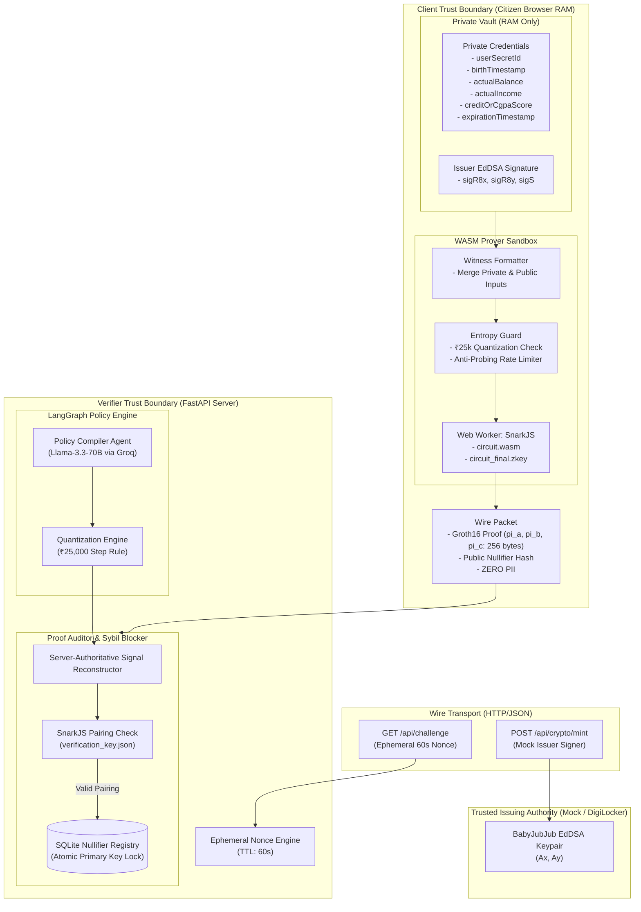

# zkode: System Architecture & Cryptographic Specification (`architecture.md`)

## 1. Executive Summary & Core Mission
`zkode` is a zero-knowledge selective disclosure and dynamic eligibility verification engine. It allows citizens to prove complex compliance credentials (e.g., age, financial stability, academic merit) without exposing underlying Raw Personal Identifiable Information (PII) such as exact birth date, real account balance, or personal identity numbers (Aadhaar/SSN).

The platform bridges two powerful technologies:
1. **Client-Side Groth16 zk-SNARKs (Circom 2.1 + SnarkJS in WebAssembly):** Mathematical proof generation running completely offline in the user's browser memory.
2. **LangGraph Dynamic Policy Compiler (Llama-3.3-70B via Groq):** Real-time transformation of plain-English statutory laws into quantized mathematical constraints without re-compiling circuits.

---

## 2. High-Level System Architecture



---

## 3. Cryptographic Circuit Specification

### 3.1 Mathematical Foundation & Parameters
* **Proof System:** Groth16 zero-knowledge succinct non-interactive argument of knowledge (zk-SNARK).
* **Curve:** `BN254` (alt_bn128), Scalar Field Prime $r$:
  $$r = 21888242871839275222246405745257275088548364400416034343698204186575808495617$$
* **Hashing Algorithm:** Poseidon hash function over BN254. Poseidon provides optimal algebraic R1CS constraint efficiency ($~200$ to $400$ constraints vs. $>25,000$ for SHA-256).
* **Signature Scheme:** BabyJubJub twisted Edwards curve with EdDSA using Poseidon hash (`EdDSAPoseidonVerifier`).
* **Trusted Setup Requirement:** Powers of Tau 14 (`pot14` = 16,384 constraints limit). The circuit requires ~4,800 to 5,200 constraints.

### 3.2 Circuit Inputs & Outputs Breakdown

#### Private Inputs (100% Client-Side RAM - Never Transmitted)
| Signal Name | Bitwidth / Domain | Description |
| :--- | :--- | :--- |
| `userSecretId` | $\mathbb{F}_r$ (254-bit) | Citizen's master private salt (acts as the identity anchor). |
| `birthTimestamp` | 64-bit integer | Date of birth formatted as `YYYYMMDD` (e.g., `20030416`). |
| `actualBalance` | 64-bit integer | Liquid balance in INR (e.g., `84500`). |
| `actualIncome` | 64-bit integer | Annual income in INR (e.g., `350000`). |
| `creditOrCgpaScore` | 32-bit integer | Scaled score: CGPA $\times 100$ (e.g., `860` for 8.60 CGPA) or CIBIL. |
| `expirationTimestamp` | 64-bit integer | Credential expiry in `YYYYMMDD` format. |
| `sigR8x` | $\mathbb{F}_r$ | BabyJubJub EdDSA signature point $R_8$ (X-coord). |
| `sigR8y` | $\mathbb{F}_r$ | BabyJubJub EdDSA signature point $R_8$ (Y-coord). |
| `sigS` | $\mathbb{F}_r$ | BabyJubJub EdDSA signature scalar $S$. |

#### Public Inputs (Server-Authoritative Signals)
| Signal Name | Description |
| :--- | :--- |
| `issuerPubKeyAx` | Trusted Issuer's public key point $A$ (X-coordinate). |
| `issuerPubKeyAy` | Trusted Issuer's public key point $A$ (Y-coordinate). |
| `currentTimestamp` | Authoritative server date in `YYYYMMDD` format. |
| `maxBirthTimestamp` | Cutoff birth date derived from minimum age requirement. |
| `minBalanceRequired` | Minimum balance threshold (quantized in ₹25k steps). |
| `maxIncomeAllowed` | Income ceiling threshold (quantized in ₹25k steps). |
| `minScoreRequired` | Minimum CGPA / credit score required. |
| `serviceScopeId` | Unique ID of the campaign, service, or grant. |
| `sessionChallengeNonce` | Single-use 60-second challenge nonce from verifier. |

#### Public Outputs
| Signal Name | Description |
| :--- | :--- |
| `isEligible` | Circuit verification outcome (`=== 1`). |
| `nullifierHash` | Sybil-resistant hash: $\text{Poseidon}(\text{userSecretId}, \text{serviceScopeId})$. |

---

## 4. Threat Matrix & Cryptographic Mitigations

```
                ┌────────────────────────────────────────────────────────┐
                │                   THREAT SURFACE                       │
                └───────────────────────────┬────────────────────────────┘
                                            │
        ┌───────────────────┬───────────────┴───────────────┬───────────────────┐
        ▼                   ▼                               ▼                   ▼
┌───────────────┐   ┌───────────────┐               ┌───────────────┐   ┌───────────────┐
│ Frankenstein  │   │ Linkability & │               │ Replay Attack │   │ Binary-Search │
│   Collusion   │   │ Tracking Risk │               │ (Stolen Proof)│   │ Range Probing │
└───────┬───────┘   └───────┬───────┘               └───────┬───────┘   └───────┬───────┘
        │                   │                               │                   │
        ▼                   ▼                               ▼                   ▼
┌───────────────┐   ┌───────────────┐               ┌───────────────┐   ┌───────────────┐
│Holder Binding │   │In-Circuit     │               │Ephemeral      │   │Quantization & │
│Poseidon Hash  │   │BabyJubJub     │               │Session Nonce  │   │Local Entropy  │
│of userSecretId│   │EdDSA Check    │               │Quadratic Lock │   │Guard Engine   │
└───────────────┘   └───────────────┘               └───────────────┘   └───────────────┘
```

1. **Frankenstein Identity (Collusion):**
   * *Risk:* User mixes Alice's birth certificate with Bob's bank account statement.
   * *Defense:* Every credential binds to `holderCommitment = Poseidon(userSecretId)`. The circuit enforces that every credential verified in the proof contains this exact hidden commitment.
2. **Linkability & Cross-Service Tracking:**
   * *Risk:* If digital signatures or public keys are submitted, surveillance agencies can link a user's activities across different services.
   * *Defense:* The Issuer's EdDSA signature is a **100% private input** verified inside the circuit. Only the Issuer's public key is public.
3. **Proof Replay Attack:**
   * *Risk:* Man-in-the-middle attacker captures `proof.json` on the wire and submits it to claim the benefit.
   * *Defense:* Verifier requires a 60-second single-use challenge nonce. The circuit enforces `nonceLock <== sessionChallengeNonce * sessionChallengeNonce`.
4. **Flash-Loan / Stale Credential:**
   * *Risk:* User takes a short-term loan, obtains a verified balance statement, pays off the loan, and uses the proof months later.
   * *Defense:* Circuit enforces `expirationTimestamp >= currentTimestamp` against server-supplied authoritative time.
5. **Binary-Search Probing:**
   * *Risk:* Malicious verifier runs sequential queries (`>= 50,000`, `>= 75,000`, `>= 62,500`) to pinpoint exact balance.
   * *Defense:* Client-side `Entropy Guard` enforces threshold quantization to ₹25,000 steps and throttles automated rapid queries.
6. **Public Signal Tampering:**
   * *Risk:* Client modifies public signals in transit (e.g., sets `minBalanceRequired = 0`).
   * *Defense:* The backend **never** reads public signals from the client payload. The backend reconstructs public signals exclusively from its internal database and verifies the client's proof against this reconstructed array.

---

## 5. Technology Stack & Component Responsibilities

| Layer | Technology | Primary Responsibility |
| :--- | :--- | :--- |
| **Circuits** | Circom 2.1.6, SnarkJS, circomlib | Multi-credential mathematical constraint verification, BabyJubJub EdDSA, Poseidon hashing. |
| **Frontend UI** | Next.js 14 (App Router), Tailwind CSS, Lucide React | 3-Column Glass-Box UI, live packet inspector, pre-flight audit, red-team simulation bar. |
| **Client Prover** | SnarkJS WebAssembly via dedicated Web Worker | Non-blocking witness resolution and Groth16 proof generation in browser background thread. |
| **Backend API** | FastAPI (Python 3.11), Uvicorn | Session challenge generation, authoritative public signal compilation, Groth16 verification, audit logs. |
| **Agentic Core** | LangGraph, LangChain, ChatGroq (`llama-3.3-70b-versatile`) | Natural language statutory policy compiler to quantized JSON with zero-temperature structured output. |
| **Persistence** | SQLite3 (`zkode_registry.db`) | Atomic nullifier deduplication (`PRIMARY KEY(nullifier_hash, service_scope_id)`). |

---

## 6. Monorepo Structure

```text
zkode/
├── circuits/
│   ├── universal_eligibility_v2.circom
│   ├── compile.sh
│   ├── input_mock.json
│   └── build/
│       ├── universal_eligibility_v2.r1cs
│       ├── circuit_final.zkey
│       ├── verification_key.json
│       └── universal_eligibility_v2_js/
│           └── universal_eligibility_v2.wasm
├── frontend/
│   ├── next.config.mjs
│   ├── package.json
│   ├── public/
│   │   ├── zk/
│   │   │   ├── circuit.wasm
│   │   │   ├── circuit_final.zkey
│   │   │   └── verification_key.json
│   │   └── workers/
│   │       └── zkProver.worker.ts
│   └── src/
│       ├── app/
│       │   ├── layout.tsx
│       │   ├── page.tsx
│       │   └── api/
│       │       └── crypto/mint/route.ts
│       ├── components/
│       │   ├── PrivateVault.tsx
│       │   ├── NetworkInspector.tsx
│       │   ├── VerifierPortal.tsx
│       │   └── RedTeamAttackBar.tsx
│       └── lib/
│           ├── entropyGuard.ts
│           ├── witnessBuilder.ts
│           └── zkProver.ts
├── backend/
│   ├── requirements.txt
│   ├── app/
│   │   ├── main.py
│   │   ├── core/
│   │   │   ├── config.py
│   │   │   ├── database.py
│   │   │   └── verification_key.json
│   │   ├── schemas/
│   │   │   └── policy.py
│   │   └── agents/
│   │       ├── policy_compiler.py
│   │       └── proof_auditor.py
│   └── tests/
│       └── test_attacks.py
└── docs/
    ├── architecture.md
    ├── backendschema.md
    ├── appflow.md
    ├── frontenddesign.md
    └── implementation.md
```

